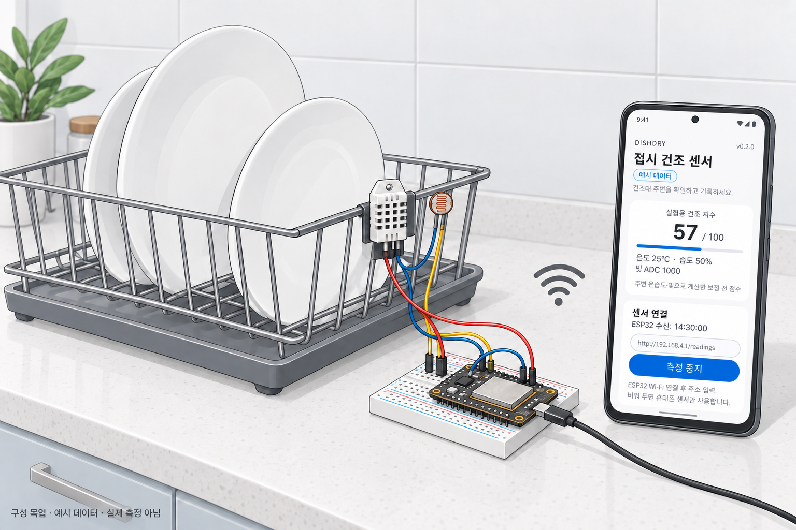
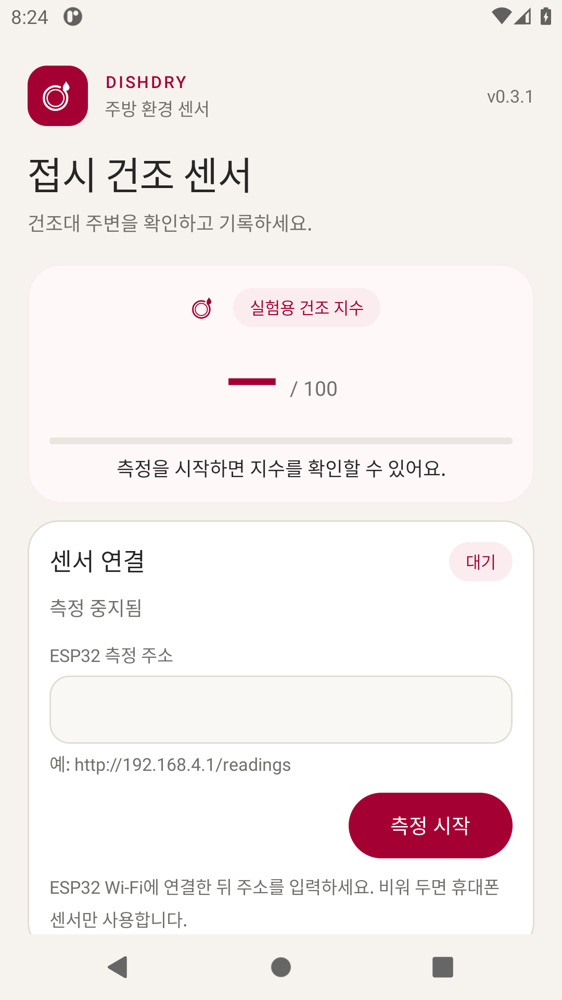
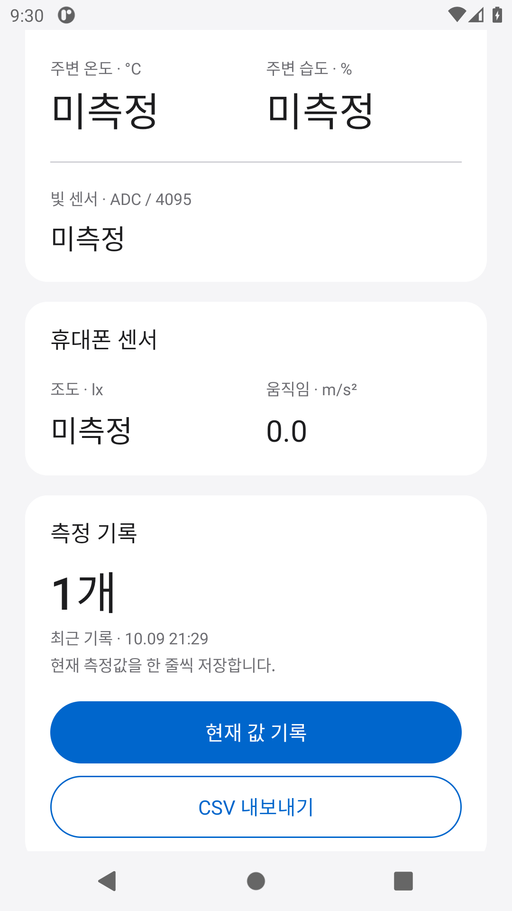
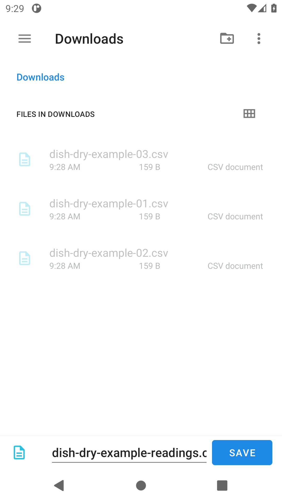
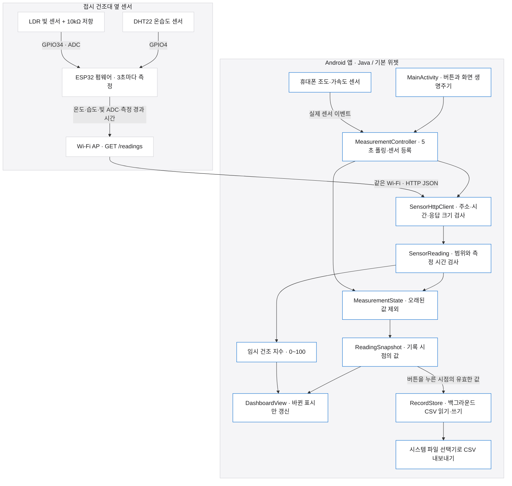
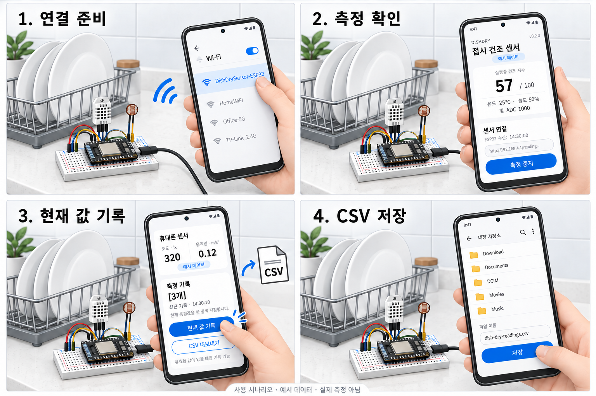
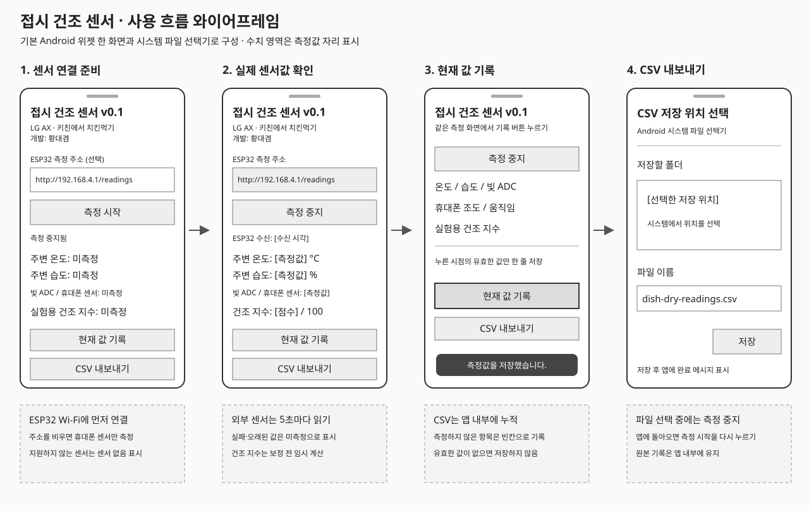

# LG AX · 키친에서 치킨먹기 — 접시 건조 센서 Android

**개발: 황대겸 ([unknownamed](https://github.com/unknownamed))**

검색 표기: **lgax키친에서 치킨먹기 / LG AX 키친에서 치킨먹기**

주방 UX/UI 시나리오를 소재로 만드는 작은 안드로이드 앱입니다. 접시 건조대 옆에 온습도·빛 센서를 붙이고, 주변 수치만으로 건조 정도를 대략 계산해 보려는 초기 구현입니다.



*접시 건조대 옆 센서와 v0.2.0 앱을 연결하는 구성 목업. 화면 수치는 예시 데이터이며, 실물 장치 실행 사진이 아닙니다.*

## 앱 실제 실행 화면

v0.2.0 APK를 Android API 30 에뮬레이터에서 실행한 원본 캡처입니다. 흰색 카드, 연회색 바탕, 파란색 캡슐 버튼과 큰 지수를 적용했습니다. ESP32는 연결하지 않았고, 기록 1개는 에뮬레이터의 가상 휴대폰 센서 값으로 저장한 것입니다.

| 연결 대기 | 현재 값 기록 | 시스템 CSV 저장 |
| --- | --- | --- |
|  |  |  |

앱 실행, 현재 값 기록, CSV 실제 파일 내용 일치, 저장·취소 후 앱 복귀, 재시작 후 기록 유지, 320dp 너비·130% 글자 크기를 확인했습니다. [전체 실행 캡처 8장](docs/images/screenshots), [실행 결과 원문](docs/logs/2026-10-10-v0.2.0-android-emulator.txt), [실행 일지](docs/RUN_LOG.md).

화면의 색상과 여백은 내려받은 [Apple 웹디자인 분석 DESIGN.md](DESIGN.md)를 참고했습니다. 공식 Apple 디자인 문서는 아니며, Android 기본 글꼴과 위젯에 맞게 적용했습니다. [적용 기준과 출처](docs/DESIGN_NOTES.md).

## 주제의 흐름

설거지 뒤 접시가 다 말랐는지 확인하려면 건조대에 가서 눈으로 보거나 만져 보게 됩니다. 여기서 출발해, 건조대 주변의 센서 수치를 휴대폰에서 볼 수 있게 만들어 보고 있습니다.

1. **확인할 일** — 건조대에 올려 둔 접시의 건조 상태가 궁금하다.
2. **물리 센서 설치** — 건조대 옆 ESP32에 온습도 센서와 빛 센서를 붙인다.
3. **Android 연결** — 센서의 개발용 Wi-Fi에 연결하고 측정 주소를 입력한다.
4. **상태 확인** — 온도·습도·빛 원시값과 임시 건조 지수를 한 화면에서 본다.
5. **기록** — 현재 값을 저장하고 CSV로 꺼내 건조대 위치별로 비교한다.

일단 센서 수치를 읽고 저장하는 단계부터 구현했습니다. 현재 환경 점수가 실제 접시의 물기와 연결되는지는 확인하지 못했습니다. 그래서 앱에서도 건조 완료 판정 대신 실험용 지수를 표시합니다.

## 구조도



외부 센서의 온습도와 빛 ADC만 임시 건조 지수에 사용합니다. 휴대폰 센서는 별도로 수치와 기록에 표시합니다. 연결 실패나 오래된 외부 측정값은 미측정으로 처리하며, 모든 기록은 앱 내부에 저장합니다.

## 사용 시나리오

설거지 후 접시를 건조대에 올려 둔 상황입니다. 사용자는 센서 Wi-Fi에 연결하고 주변 수치를 확인한 뒤, 비교해 보고 싶은 시점에 현재 값을 기록하고 CSV로 저장합니다.



*새 화면 디자인으로 맞춘 4컷 개념 시나리오. 화면 수치와 기록 3개는 이해를 돕는 예시 데이터이며, 실물 센서 실행 기록이 아닙니다.*

## 화면 와이어프레임과 사용 흐름



구성 목업·시나리오·와이어프레임에는 같은 **예시 데이터**를 사용했습니다. 온도 **25°C**, 습도 **50%**, 빛 **ADC 1000**을 임시 계산식에 넣으면 지수는 약 57.44이며 앱의 정수 표시는 **57 / 100**입니다. 휴대폰 조도 **320 lx**, 움직임 **0.12 m/s²**, 기록 **3개**와 표시 시각도 가상 예시입니다.

1. **연결 준비** — ESP32의 `DishDrySensor-ESP32` Wi-Fi에 연결하고 앱에 `http://192.168.4.1/readings`를 입력합니다. 주소를 비우면 휴대폰 센서만 사용합니다.
2. **측정 시작** — `측정 시작`을 누르면 지원되는 휴대폰 센서를 읽고, 외부 주소가 있으면 5초마다 ESP32 측정값을 요청합니다. 연결 상태와 센서 수치, 임시 건조 지수를 확인합니다.
3. **현재 값 기록** — `현재 값 기록`을 누른 시점의 유효한 값을 앱 내부 CSV에 한 줄씩 저장합니다. 미측정 항목은 빈칸으로 남고, 모든 값이 없으면 저장하지 않습니다.
4. **CSV 저장** — `CSV 내보내기`를 눌러 시스템 파일 선택기에서 저장 위치를 고릅니다. 파일 이름은 `dish-dry-readings.csv`입니다. 저장된 기록이 없으면 내보내기를 진행하지 않습니다.

연결 준비 화면의 대시는 측정 전 상태를 뜻합니다. 예시 수치는 개념 그림에만 사용하며, 위의 실제 앱 실행 캡처와 검증 로그는 원본입니다. 파일 선택기를 포함해 앱 화면을 벗어나면 측정은 중지됩니다. 앱에 돌아온 뒤 계속 측정하려면 `측정 시작`을 다시 눌러야 합니다.

## 지금 구현된 것

- ESP32의 DHT22 온습도와 LDR 빛 센서 측정값을 HTTP로 읽기
- 휴대폰 조도 센서와 가속도 센서 읽기
- 단순한 0~100 건조 지수 표시
- 버튼을 누른 시점의 측정값을 앱 내부에 기록하고 CSV로 내보내기
- 시간 초과·주소·센서 응답 오류별 안내와 자동 재연결 상태 표시
- 센서 미지원, 센서 읽기 실패 표시

화면은 기본 Android 위젯으로 만든 한 페이지입니다. 지수·연결·외부 센서·휴대폰 센서·기록을 카드로 배치하고 기록 개수와 최근 기록 시각을 표시합니다. 화면 표시, 측정 상태, HTTP 요청, CSV 저장을 분리했습니다. CSV 읽기·쓰기·내보내기는 백그라운드에서 실행합니다. ESP32 수치는 5초마다 읽고, 실제로 수신한 값만 표시합니다. 센서를 연결하지 않으면 해당 항목은 미측정으로 남습니다. 외부 센서 없이 휴대폰 센서만 켤 수도 있습니다.

## 개발 단계

v0.2.1. 연결 실패 원인별 확인 안내와 다음 요청 대기·다시 연결 중 상태를 추가했습니다. 위 실행 화면은 v0.2.0 캡처입니다. 앱과 ESP32 펌웨어를 구현한 상태이며, 실제 건조대에서의 보정, 접시 물기와의 상관관계, 여러 휴대폰에서의 동작은 아직 확인하지 않았습니다. 주변 습도와 밝기가 접시의 건조 완료를 나타낸다는 가정도 검증 전입니다.

건조 지수는 임의 가중치의 환경 점수입니다. 접시 표면 수분이나 건조 완료를 직접 측정하는 값은 아닙니다. 환기, 식기 재질, 물방울 크기 등을 반영하지 못합니다.

## 간단한 작업 문서

- [간단 명세](docs/SPEC.md) — 화면·버튼, 센서 연결, HTTP 응답, CSV 열 정리
- [화면 기준과 코드 구조](docs/DESIGN_NOTES.md) — DESIGN.md 출처, Android 적용, 파일별 책임
- [개발·실행 기록](docs/RUN_LOG.md) — 빌드 출력과 실물 장치 확인 항목
- [개발 메모와 남은 작업](docs/TODO.md) — 구현한 코드와 기기에서 확인할 항목

## Android 실행

Android 8.0 이상, JDK 17 이상, Android SDK 35가 필요합니다. Android Studio에서 이 폴더를 열거나 다음 명령으로 빌드합니다.

```sh
./gradlew assembleDebug
```

Windows에서는 `gradlew.bat assembleDebug`를 실행합니다. APK는 `app/build/outputs/apk/debug/app-debug.apk`에 만들어집니다. GitHub Actions의 `dish-dry-android-debug` 아티팩트에서도 받을 수 있습니다.

앱에서 `측정 시작`을 누르면 휴대폰의 실제 센서값이 표시됩니다. ESP32 주소는 선택 사항입니다. `현재 값 기록`으로 저장하고 `CSV 내보내기`로 파일을 선택합니다. 화면을 벗어나면 측정을 멈추며, 돌아온 뒤 다시 시작해야 합니다.

## ESP32 연결

기준 보드는 일반 ESP32 DevKit입니다. ESP32-C3 등 다른 보드는 아래 핀 번호를 그대로 사용할 수 없습니다.

| 부품 | 연결 |
| --- | --- |
| DHT22 VCC / GND | 3.3V / GND |
| DHT22 DATA | GPIO4, DATA와 3.3V 사이 10kΩ 풀업 |
| LDR | 3.3V → LDR → GPIO34 → 10kΩ 저항 → GND |

Arduino IDE에 ESP32 보드 패키지와 Adafruit `DHT sensor library` 및 `Adafruit Unified Sensor`를 설치하고 `firmware/dish_dry_sensor/dish_dry_sensor.ino`를 업로드합니다.

펌웨어가 만드는 개발용 Wi-Fi `DishDrySensor-ESP32`에 연결합니다. 개발용 비밀번호는 `dishdry123`입니다. 인터넷이 없는 네트워크이므로 Android의 연결 유지 안내를 선택해야 할 수 있습니다.

앱에 `http://192.168.4.1/readings`를 입력하고 측정을 시작합니다. DHT22는 3초 간격으로 측정합니다. 읽기에 실패하면 HTTP 503을 반환하며, 앱은 값을 만들어 채우지 않습니다. LDR 값은 보정되지 않은 12비트 ADC 원시값으로, lux가 아닙니다.

## 임시 계산

```text
건조 지수 = (100 - 습도) × 0.8 + (온도 - 15) × 1.5 + (빛 ADC / 4095) × 10
표시 범위 = 0~100
```

휴대폰 움직임은 가속도 벡터의 크기에서 표준 중력값을 뺀 절댓값입니다. 건조 지수에는 사용하지 않고 숫자만 표시합니다.

## 다음 작업

- 건조대 위치와 식기 재질에 따른 센서 보정
- 임시 지수와 실제 물기 비교
- 연결 주소 입력 방식과 화면 배치 개선
- 실물 기기에서 연결 끊김과 자동 재연결 안내 확인
