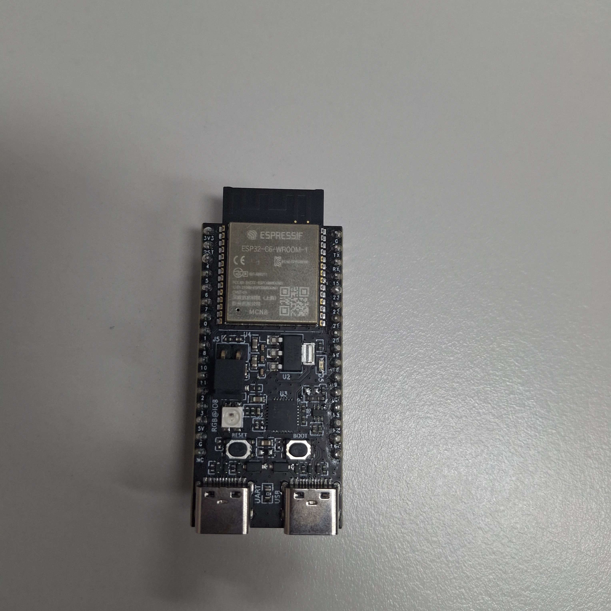
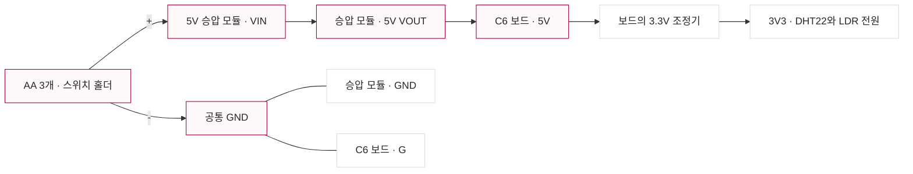
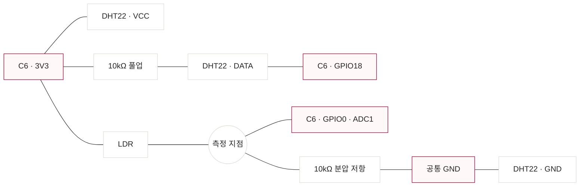

# ESP32-C6 · 건전지 전원 배선

LG AX · 키친에서 치킨먹기 / 황대겸

기준은 제공된 사진의 ESP32-C6-WROOM-1 개발보드와 ESP32-C6-DevKitC-1 헤더 배치다. [Espressif 공식 핀·전원 안내](https://docs.espressif.com/projects/esp-dev-kits/en/latest/esp32c6/esp32-c6-devkitc-1/user_guide.html)를 기준으로 작성했다. 보드의 기판 표기 `18`, `0`, `5V`, `3V3`, `G`를 확인한다.

## 준비할 부품

| 부품 | 수량 | 역할 |
| --- | --- | --- |
| ESP32-C6-WROOM-1 개발보드 | 1개 | 센서 수치와 Wi-Fi |
| AA 알카라인 건전지·스위치 홀더 | 3개·1개 | 설치 시 전원, 정격 합계 4.5V |
| 정전압 5V 승압 모듈 | 1개 | 건전지 전압을 보드 5V 입력으로 공급 |
| DHT22 | 1개 | 온도·습도 |
| LDR·10kΩ 저항 | 1개·2개 | 빛 분압·DHT DATA 풀업 |
| 점퍼선·연결용 소형 브레드보드 | 필요한 만큼 | 센서·전원 연결 |
| USB 데이터 케이블 | 1개 | 펌웨어 업로드 시 사용 |

전원 모듈의 기준 부품은 [Pololu U3V16F5, 5V 승압 모듈](https://www.pololu.com/product/4941)이다. 해당 부품은 시동에 최소 2.7V가 필요하며, 입력이 설정 출력보다 높으면 출력도 입력을 따라갈 수 있다. 이 구성은 **AA 3개**로 맞추고 4개 팩이나 더 높은 전압으로 임의 변경하지 않는다. 보드에 연결하기 전에 출력이 5V인지 확인한다.

## 건전지 전원

| 전원 선 | 연결 |
| --- | --- |
| 건전지 홀더 + / − | 승압 모듈 VIN / GND |
| 승압 모듈 5V 출력 / GND | 보드 `5V` / `G` |
| 센서 VCC / GND | 보드 `3V3` / `G` |

설치 때는 USB 케이블을 연결하지 않는다. 업로드 때는 건전지 승압 모듈의 출력을 보드에서 분리한 뒤 USB를 연결한다. 공식 보드 안내의 USB·5V 핀·3V3 핀 전원 방식은 서로 독립적으로 선택하는 방식이다. 배선 변경은 전원을 끈 상태에서 한다.

현재 펌웨어는 Wi-Fi AP를 유지해 앱의 요청을 받는다. 사용 시간과 소비 전류는 건전지 종류·무선 상태에 따라 확인할 항목이며, 며칠 사용 가능하다는 수치를 가정하지 않는다.

## 센서 연결

| 센서 선 | 연결 |
| --- | --- |
| DHT22 VCC / GND | `3V3` / `G` |
| DHT22 DATA | `GPIO18`, DATA와 3V3 사이 10kΩ |
| LDR | `3V3 → LDR → 측정 지점 → 10kΩ → G` |
| LDR 측정 지점 | `GPIO0` |

DHT22·모듈마다 핀 순서가 다를 수 있으므로 VCC/DATA/GND 표기를 확인한다. NC는 연결하지 않는다. 풀업이 포함된 모듈은 부품의 회로 안내를 따른다. [Adafruit DHT 배선 안내](https://learn.adafruit.com/dht/connecting-to-a-dhtxx-sensor).

GPIO18은 센서 신호에, GPIO0은 ADC1 입력에 사용한다. USB 핀 GPIO12·13, RGB LED GPIO8, 부트 설정 핀 GPIO4·5·8·9·15를 센서 배선에 사용하지 않는다. 기존 일반 ESP32의 GPIO34 배선은 이 C6 보드에 적용하지 않는다.

## 업로드와 확인

1. 건전지 출력선을 분리하고 보드의 USB-UART 포트에 데이터 케이블을 연결한다.
2. Arduino IDE에서 `ESP32C6 Dev Module`을 선택한다. CLI는 `esp32:esp32:esp32c6`을 사용한다.
3. [펌웨어](../firmware/dish_dry_sensor/dish_dry_sensor.ino)를 업로드하고 Serial Monitor `115200 baud`에서 주소를 확인한다.
4. USB를 분리하고 건전지 승압 출력의 5V·GND를 보드에 연결한 뒤 홀더 스위치를 켠다.
5. `DishDrySensor-ESP32` Wi-Fi에 연결하고 앱에 `http://192.168.4.1/readings`를 입력한다.
6. 온도·습도·빛 ADC, 기록과 CSV 저장을 확인한다. 보드·전원 부품·확인 날짜·응답 원문을 [실행 기록](RUN_LOG.md)에 남긴다.

| 증상 | 확인할 곳 |
| --- | --- |
| 전원은 켜지지만 HTTP 503 | 첫 3초 측정을 기다린 뒤 DHT 전원·GPIO18·풀업 |
| 빛 ADC가 계속 0 또는 4095 | GPIO0이 LDR과 저항 사이에 연결됐는지 |
| Wi-Fi 연결 때 재시작 | 건전지 접점과 승압 모듈의 부하 시 5V 출력 |
| Wi-Fi가 보이지 않음 | 전원 스위치·5V·GND·업로드 결과 |
| HTTP 404 | 주소의 `/readings` 경로 |

ADC는 0~4095 원시값이며 lux가 아니다. 임시 지수와 실제 접시 물기의 관계, 실물 배선과 건전지 사용 시간은 별도 확인한다.
