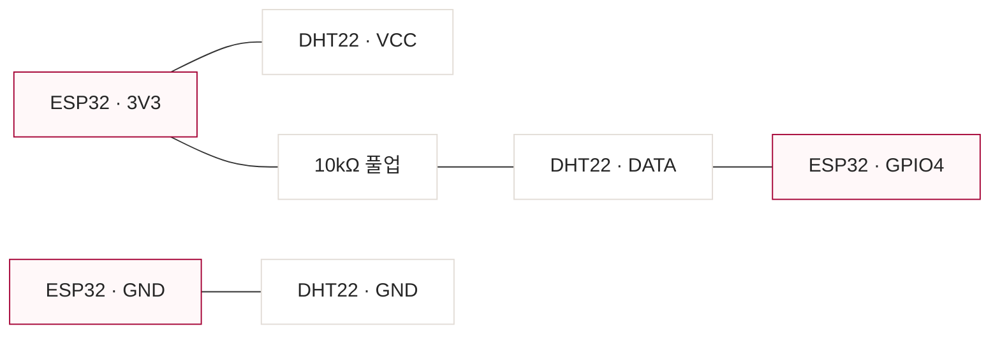
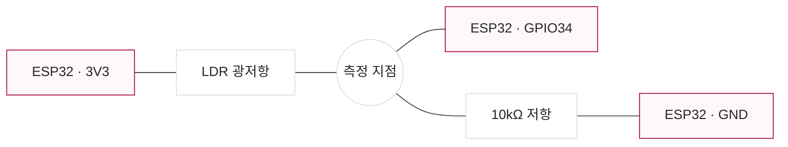

# ESP32 센서 배선 안내

LG AX · 키친에서 치킨먹기 / 황대겸

대상은 GPIO4·GPIO34가 노출된 일반 ESP32 DevKit이다. 핀 옆의 `3V3`, `GND`, `4`, `34` 표기를 확인한다. ESP32-C3·S3 등 다른 칩의 보드에 이 핀 번호를 그대로 적용하지 않는다. 이 문서는 [현재 펌웨어](../firmware/dish_dry_sensor/dish_dry_sensor.ino)의 연결 계획이며, 실물 배선·업로드 확인은 [실행 기록](RUN_LOG.md)에 따로 남긴다.

## 준비할 부품

| 부품 | 수량 | 용도 |
| --- | --- | --- |
| ESP32 DevKit·USB 케이블 | 각 1개 | 전원·업로드·개발용 Wi-Fi |
| DHT22 | 1개 | 온도·습도 |
| LDR 광저항 | 1개 | 주변 밝기의 원시값 |
| 10kΩ 저항 | 2개 | DHT DATA 풀업·LDR 분압 |
| 브레드보드·점퍼선 | 필요한 만큼 | 공통 전원과 신호 연결 |

아래 연결은 센서 쪽 전원을 모두 보드의 `3V3`에서 받는 구성이다. 배선은 USB 전원을 분리한 상태에서 한다. DHT22 센서와 모듈은 핀 순서가 다를 수 있으므로 부품의 `VCC/DATA/GND` 표기를 확인한다. 사용하지 않는 NC 핀이 있으면 연결하지 않는다.

## DHT22 · 온습도

| DHT22 쪽 | 연결할 곳 |
| --- | --- |
| VCC | ESP32 `3V3` |
| GND | ESP32 `GND` |
| DATA | ESP32 `GPIO4` |
| 10kΩ 저항 | DATA와 `3V3` 사이 |

DATA 풀업을 포함한 모듈은 모듈의 회로 안내를 확인한다. 3.3V DATA 풀업 연결의 기준은 [Adafruit DHT 배선 안내](https://learn.adafruit.com/dht/connecting-to-a-dhtxx-sensor)다. 이 프로젝트는 DHT22를 3초마다 읽으며 첫 측정 전 또는 읽기 실패 때는 HTTP 503을 반환한다.

## LDR · 빛 센서

LDR 한쪽을 `3V3`에 연결한다. 다른 쪽은 `GPIO34`와 10kΩ 저항의 한쪽을 함께 연결하는 측정 지점이다. 저항의 나머지 쪽은 `GND`에 연결한다. 즉, `3V3 → LDR → 측정 지점 → 10kΩ → GND`이고 측정 지점에서 GPIO34로 선을 뺀다.

GPIO34는 입력 전용 ADC1 핀이다. 보드의 전원·GPIO 이름은 [Espressif ESP32 DevKit 핀 안내](https://docs.espressif.com/projects/arduino-esp32/en/latest/boards/ESP32-DevKitC-1.html)를 참고한다. 현재 펌웨어는 12비트 ADC 원시값 0~4095를 사용하며 lux로 변환하지 않는다.

## 연결 뒤 확인 순서

1. `3V3`와 `GND`, DHT DATA 풀업, LDR 측정 지점과 GPIO34 연결을 다시 확인한다.
2. [펌웨어](../firmware/dish_dry_sensor/dish_dry_sensor.ino)를 업로드하고 Serial Monitor를 `115200 baud`로 연다.
3. Serial에 표시되는 `Sensor endpoint: http://.../readings` 주소를 확인한다. 기본 설정은 `http://192.168.4.1/readings`다.
4. 휴대폰에서 `DishDrySensor-ESP32` Wi-Fi에 연결하고 앱에 주소를 입력한다. 개발용 비밀번호는 README의 연결 안내를 따른다.
5. 측정을 시작해 온도·습도·빛 ADC가 표시되는지 확인한다. LDR을 가리고 다시 빛을 비춰 값의 변화를 비교한다.
6. `현재 값 기록`과 `CSV 내보내기`로 값을 저장한다. 보드·센서·확인 날짜·응답 원문을 실행 기록에 함께 남긴다.

| 증상 | 확인할 연결 |
| --- | --- |
| 전원은 들어오지만 HTTP 503 | 첫 3초 측정을 기다린 뒤 DHT 전원·DATA·풀업 확인 |
| 빛 ADC가 계속 0 또는 4095 | GPIO34가 LDR과 저항 사이에 연결됐는지, 전원·GND 분압 연결 확인 |
| 센서 Wi-Fi가 보이지 않음 | USB 전원·업로드 결과·Serial 출력 확인 |
| HTTP 404 | 측정 주소의 `/readings` 경로 확인 |

배선·통신 확인 뒤에도 임시 지수가 실제 접시 물기를 설명하는지는 별도 실험이 필요하다.
